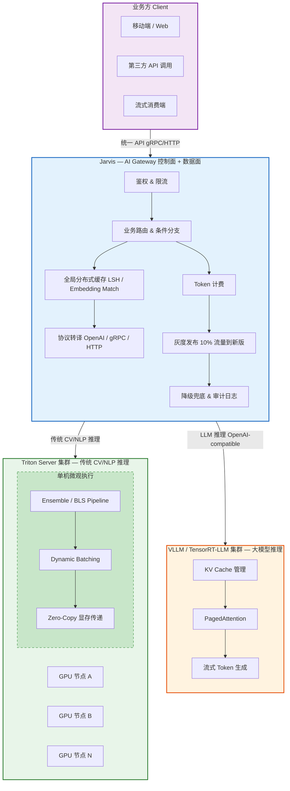

# Jarvis 与 Triton Server 架构分析

ML 模型部署与配置平台的架构核心由两层组成：AI 网关服务 **Jarvis**（宏观编排）和推理引擎 **Triton Server**（微观执行）。下面分析为什么工业界实践中"必须"有 Jarvis 这一层，以及两者 Pipeline 的互补关系。

## 一、为什么必须要有 Jarvis 层

只靠 Triton 无法支撑大规模生产环境。Jarvis 的存在有三个不可替代的底层逻辑：

### 1. 防范外挂业务逻辑阻塞算力引擎

完整的推理流通常包含：用户鉴权、Token 计费、外部数据库查询、基于业务规则的 If/Else 分支。

如果在 Triton 内部（如 Python BLS）编写这些网络 I/O 代码，会直接阻塞 Triton 的 C++ 线程池，导致 GPU 吞吐量断崖式下跌。**Jarvis 在外层拦截并处理了所有非计算类逻辑。**

**量化视角**：Triton C++ backend 线程池默认大小通常与 CPU 核数相当（8-16 个线程）。如果 Python BLS 中执行一次 200ms 的外部 DB 查询，单请求占住一个线程 200ms，QPS 上限即 `线程数 / 0.2s ≈ 40-80 QPS`——远在 GPU 实际算力之下。而 Jarvis 的 async HTTP 架构可以将此提升到上万 QPS。

### 2. 全局缓存（Global Cache）的经济价值

Triton 的缓存是单机进程内的。在分布式多节点的集群中，负载均衡会将相同请求打到不同机器，导致单机缓存命中率极低。

Jarvis 作为统一入口，对接全局分布式缓存，在请求进入昂贵的 GPU 服务器之前将其拦截并直接返回，能为企业节省巨大的显卡带宽与算力成本。

**进阶实践**：缓存不是简单的 exact-match KV store。输入图片经过 resize/crop 预处理后 Hash 改变但语义不变，Jarvis 层可引入 LSH（局部敏感哈希）或 embedding-based match，命中率远高于 Triton 的单机精确匹配缓存。

### 3. 异构引擎的"大一统"隔离

现代 AI 架构不可能只运行 Triton。大模型（LLM）往往需要 VLLM 或 TensorRT-LLM 才能发挥极致性能。

Jarvis 屏蔽了底层的物理拓扑和引擎差异，业务方只需盲调 Jarvis，由 Jarvis 编排 "Triton（传统 CV/NLP）+ VLLM（大模型产生 Token）" 的混合工作流。

**协议转译关键点**：VLLM/TensorRT-LLM 的请求协议（OpenAI-compatible `/v1/chat/completions`）与 Triton 的 gRPC/HTTP 协议完全不同。没有中间层做协议转译，业务方无法"盲调"。Jarvis 在这里承担的不只是路由，还有协议归一化。

## 二、Jarvis Pipeline vs Triton Pipeline

两者都有 Pipeline 能力，但层次和目的截然不同，呈互补关系：

### Jarvis Pipeline：宏观分布式编排（Macro-Orchestration）

| 维度 | 特征 |
|---|---|
| **作用域** | 跨节点与跨引擎：节点可以是多台 Triton 服务器，也可以是远程 VLLM 集群或外部第三方 API |
| **数据特征** | 轻 Tensor / 重逻辑：适合复杂业务流控制（条件路由、降级兜底、流式数据转换、安全内容审计） |
| **控制面能力** | 具备微服务特性，支持按权重做模型版本的灰度发布（如 10% 流量走新版推理流） |

### Triton Pipeline：微观单机执行（Micro-Execution）

| 维度 | 特征 |
|---|---|
| **作用域** | 严格局限在单台服务器内部（Ensemble / BLS） |
| **数据特征** | 重 Tensor / 极致吞吐：前一个模型输出 Tensor 直接通过内存/显存指针传给下一个模型 |
| **优化方式** | 零拷贝（Zero-Copy）消除网络传输序列化开销；天然集成动态批处理（Dynamic Batching）与多模型并发（Concurrent Execution），将 GPU 硬件利用率压榨到极限 |

## 三、架构全景

## 四、总结

| 层次 | Jarvis | Triton |
|---|---|---|
| **定位** | 控制面 + 数据面网关 | 纯计算引擎 |
| **关注点** | 业务正确性、成本效率、灰度安全 | GPU 利用率、延迟/吞吐、显存管理 |
| **编排粒度** | 跨服务、跨集群、跨引擎 | 单机内、模型间 |
| **典型时延** | 毫秒级路由/缓存命中 | 亚微秒级 Tensor 传递 |

Jarvis 不是 Triton 的替代，而是它的"外交层"——把 Triton 从业务逻辑、协议差异、缓存策略中解放出来，让它专注做好一件事：用最快的速度跑模型。
