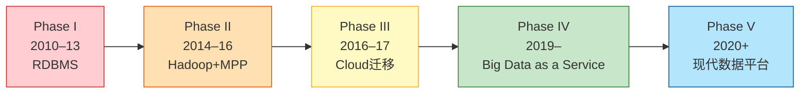
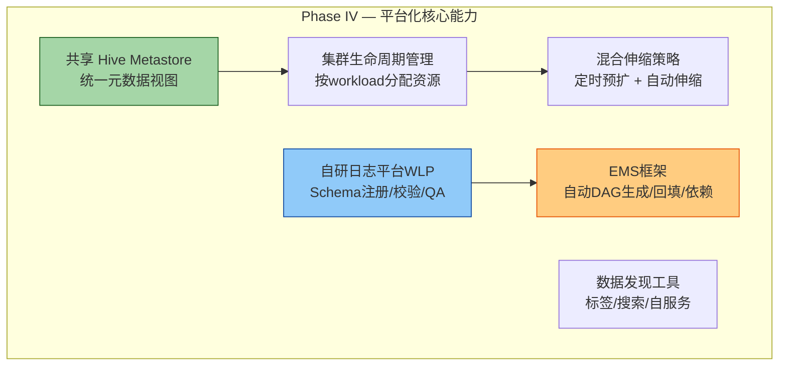
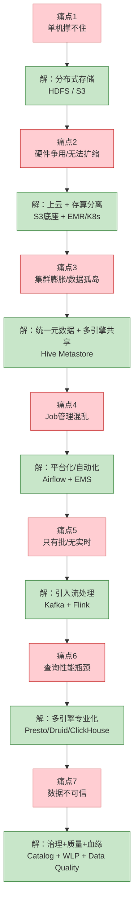

# Coupang 数据平台演进路线 & 核心优化总结

> 基于文章 [Evolving the Coupang Data Platform](https://medium.com/coupang-engineering/evolving-the-coupang-data-platform-308e305a9c45) (2019)
> 结合 Coupang 架构图（后期状态），构建完整演进路线图

## 1. 五阶段演进总览

## 2. 各阶段详细对比

### Phase I — 关系型数据库时代 (2010–13)

| 维度 | 状态 |
|---|---|
| 存储 | MySQL / Oracle 单体数据库 |
| 计算 | SQL 查询直接在数据库上跑 |
| 数据量 | 小规模，单机能撑住 |
| 团队 | 无专职数据团队 |
| **瓶颈** | BI 查询量暴增后，速度和规模跟不上 |

**核心矛盾**：RDBMS 做 OLTP 可以，做 OLAP 撑不住。

### Phase II — 大数据起步 (2014–16)

| 维度 | 状态 |
|---|---|
| 存储 | HDFS（Hadoop）+ MPP 数据库 |
| 计算 | Hive SQL、MapReduce |
| 基础设施 | 自建机房/on-premise |
| 团队 | Log Collection 团队成立 |
| **瓶颈** | MPP 并发上限 → Hive 从早 8 点挂到半夜；硬件是所有用户的单一争用点（SPOF），无法弹性扩容 |

**核心矛盾**：on-premise 硬件无法动态扩缩；所有 workload 争抢同一套硬件，用户被迫凌晨跑查询。

**文章原话**：
> "One hardware became almost the single point of contention for all users' data retrieval"

**优化方向**：存算分离的原始动机出现了——不再让同物理机同时承担存储和计算。

### Phase III — 上云重构 (2016–17)

| 维度 | 状态 |
|---|---|
| 存储 | 云上对象存储 + MPP |
| 计算 | Hadoop / 容器化工具 |
| 架构 | 三层数仓：DAP（数据获取）/ Sandbox（沙箱）/ Reporting（报表） |
| 改进 | 弹性扩容、星型模型 EDW |
| **瓶颈** | Job 提交混乱、集群数量膨胀、日志质量差 |

**文章原话**：
> "Each team wanted to own their own Hadoop cluster and as the number of clusters grew, operational difficulties arose"

**核心矛盾**：上云解决了物理扩容问题，但暴露了管理问题——团队各自建集群形成"数据飞地"，存储和计算实际上还是耦合的。

### Phase IV — 平台化 (2019)

| 维度 | 状态 |
|---|---|
| 存储 | 云存储 + 共享 Hive Metastore |
| 计算 | Hadoop 集群按生命周期管理；定时 + 自动伸缩混合 |
| 数据质量 | 数据质量框架、SLA 通知、数据发现工具 |
| 日志平台 | 自研 Web Logging Platform（WLP）：Schema 注册、校验服务、端到端测试 |
| 调度 | Airflow + EDW Management System（自动 DAG 生成）|

**关键里程碑**：

**核心矛盾**：虽然存储和元数据已统一，但还停留在 Hadoop/MPP + 批处理范式，缺乏实时流处理能力。

### Phase V — 现代数据平台 (2020+，对应架构图)

*此阶段未在 2019 文章中详述，但已体现在我们复刻的架构图中：*

| 维度 | 状态 |
|---|---|
| 存储 | S3 数据湖 + Hive Metastore + Iceberg 表格式 |
| 实时 | Kafka + Flink + Flink SQL + ksqlDB |
| 批量 | Spark + Hive + Airflow |
| 查询 | Presto/Trino + Druid + ClickHouse |
| 治理 | Data Catalog、数据血缘、质量监控 |

## 3. 核心优化路线图

从 Coupang 的演进中，可以提炼出一条**数据平台优化的核心路线**：

## 4. 对我们的启示

对照我们之前设计的[存算分离数据平台架构](../docs/superpowers/specs/2026-07-08-data-platform-architecture-design.md)，Coupang 的演进验证了以下设计选择：

| 我们的设计选择 | Coupang 的验证 |
|---|---|
| S3/MinIO 存储底座 + K8s 计算层 | Phase III→V 的核心路径，存算分离是必经之路 |
| Hive Metastore + Parquet/ORC | Phase IV 证明共享 Metastore 是解决数据孤岛的关键 |
| Hive 先行，Iceberg 做升级 | Coupang 也是先搞 Hive 统一元数据，后来才上 Iceberg |
| Flink + Spark 双引擎 | Phase V 的架构就是流批双引擎 |
| Airflow + 数据质量框架 | Phase IV 的 EMS + Data Quality 是平台化核心 |
| WLP 式日志平台 | 你的 IoT/遥感接入管道本质上就是一回事——日志 = 事件流 |

**最关键的一条启示**：Coupang 花了近 10 年才走过这条路线。但我们现在可以**跳过那些已被验证为错的路径**（比如 on-prem Hadoop、分散 MPP 集群），直接从 Phase IV+ 开始设计，一步到位。你当前的设计方向完全正确。
