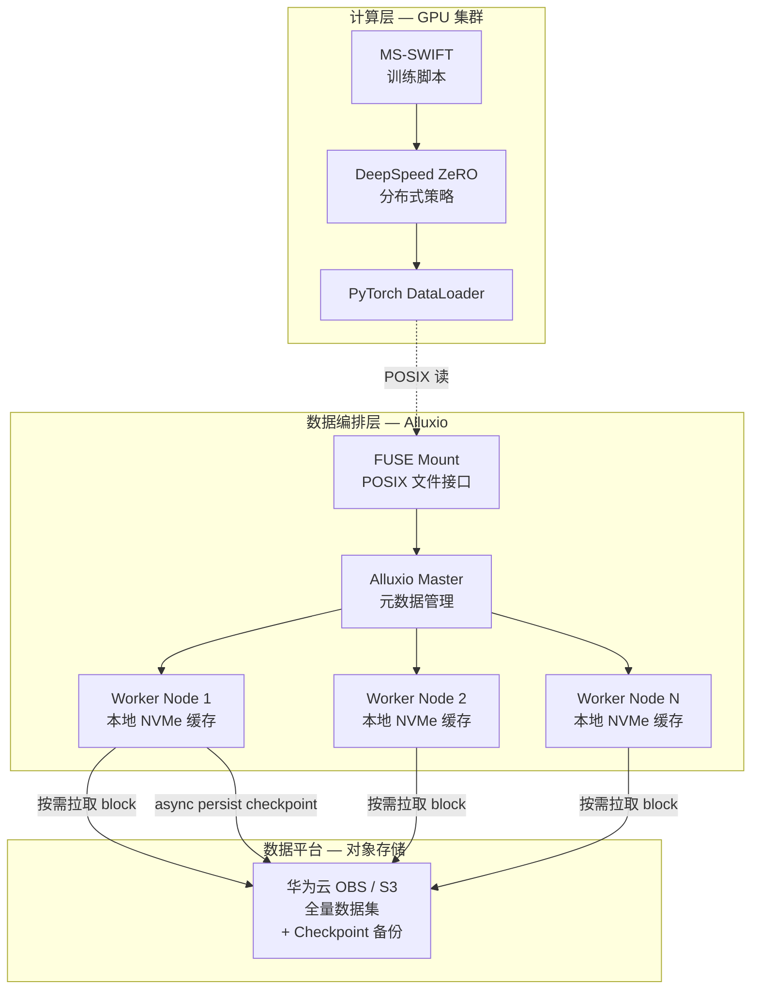
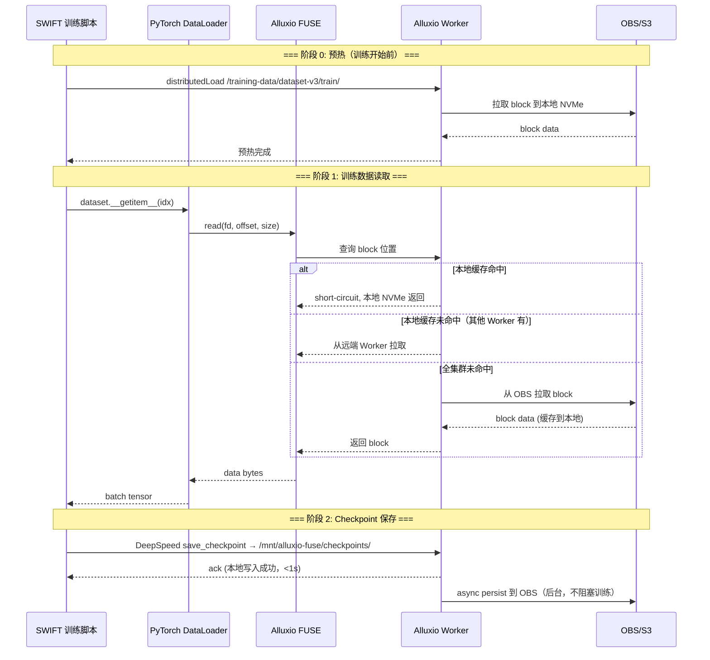
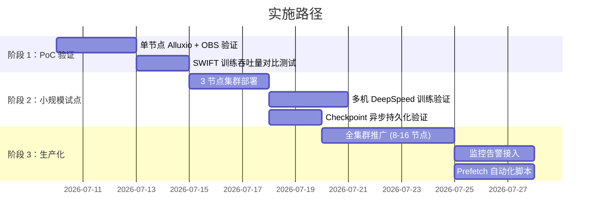

<!--meta
  date: 2026-07-05
  author: AI Platform Team
  status: draft
-->

# 多机多卡训练数据平台方案

## 一、背景与挑战

### 1.1 问题定义

在进行 **MS-SWIFT + DeepSpeed 多机多卡大规模模型训练** 时，计算平台（GPU 集群）与数据平台（对象存储 / 文件存储）之间存在一个天然的**耦合断层**。这个断层的核心矛盾在于：

- **计算侧**要求低延迟、高 IOPS、多 rank 并发亲和——GPU 不能等数据，多 rank 并发的数据读取会把远端存储的带宽和延迟问题成倍放大。
- **数据侧**本质上是对象存储（S3/OBS），设计目标为高耐久、低成本、海量容量，而非低延迟随机读取。

不做任何处理的结果：要么 GPU 空转等 IO（计算效率低），要么全量数据预拷贝到本地 NVMe（经济性差且数据管理失控）。

### 1.2 具体挑战拆解

| 维度 | 具体矛盾 | 不做处理的后果 |
|---|---|---|
| **计算效率** | N 个 GPU rank 并发读 S3 带来 N × 带宽压力 + 毫秒级延迟 | GPU 利用率常年在 40%-60%，大量时间花费在等待 I/O |
| **经济性** | 全量数据预拷贝到本地 NVMe，训练数据集动辄 TB 级 | 存储成本按 GPU 节点数线性膨胀；数据集更新后需要全量重拷 |
| **数据管理** | 多个训练任务共享同一份 S3 数据，各自独立的缓存策略形成"数据飞地" | 版本不一致、重复拉取、缺乏统一的访问控制和淘汰策略 |
| **Checkpoint 保存** | DeepSpeed 的 checkpoint 写入动辄几十上百 GB，直接写 S3 阻塞训练 | 训练暂停等待 checkpoint 上传，高频保存时损失 10%-20% 的有效训练时间 |
| **规模弹性** | 集群扩缩容时，新节点没有任何本地数据缓存，直接冷启动 | 新节点加入后前几个 epoch 完全依赖远端读取，拖慢整体训练进度 |

### 1.3 方案目标

构建一套 **数据编排中间层**，在计算平台与数据平台之间实现：

1. **透明加速**：训练代码零改动，感知不到数据来自远端还是本地
2. **按需预热**：训练开始前将所需数据预加载到各计算节点，冷启动时间控制在分钟级
3. **异步持久化**：checkpoint 先写本地再异步同步至 S3，训练不被阻塞
4. **统一命名空间**：跨节点的数据访问视图一致，消除"数据飞地"
5. **成本可控**：本地缓存容量按热点数据尺寸配置，不要求覆盖全量数据集

---

## 二、方案架构总览

### 2.1 三层数据架构



### 2.2 各层职责

| 层 | 组件 | 核心职责 |
|---|---|---|
| **计算层** | MS-SWIFT + DeepSpeed + DataLoader | 训练逻辑、分布式策略、数据读取。**零代码改动**，通过 Alluxio FUSE mount 透明访问数据 |
| **数据编排层** | Alluxio Master + Worker | 元数据管理、分布式缓存、数据本地化调度、淘汰策略、异步持久化 |
| **数据平台** | OBS / S3 | 全量数据集的 source of truth，checkpoint 的最终持久化位置 |
| **本地存储** | 各节点 NVMe SSD | Alluxio Worker 的 cache tier，承载热数据 block |

### 2.3 关键设计原则

**Colocate Worker 与 GPU**：每个 GPU 训练节点同时运行一个 Alluxio Worker 进程，确保数据本地化命中时走的是本机 NVMe 而非网络——延迟从远端 OBS 的 50-100ms 降至 sub-ms 级别。

**短路读（Short-Circuit Read）**：当 Alluxio client 与 Worker 在同一节点时，数据直接通过本地文件系统传递，跳过网络栈，避免不必要的 TCP 开销。

**Write-Through vs Async Persist**：checkpoint 写入选用 async persist 模式——Worker 先写本地缓存并立即返回成功，后台异步向 OBS 同步。训练完全不被阻塞。

---

## 三、技术细节

### 3.1 Alluxio 部署拓扑

```
┌─────────────────────────────────────────────────┐
│               Alluxio Master (HA)                │
│         元数据 / 全局视图 / 淘汰策略              │
│  ┌─────────────────────────────────────────────┐ │
│  │  Journal (Raft-based, 3 副本)               │ │
│  └─────────────────────────────────────────────┘ │
└─────────────────────────────────────────────────┘
          │                    │
          ▼                    ▼
┌──────────────────┐  ┌──────────────────┐
│  GPU Node 0      │  │  GPU Node N      │
│  ┌────────────┐  │  │  ┌────────────┐  │
│  │ Alluxio    │  │  │  │ Alluxio    │  │
│  │ Worker     │  │  │  │ Worker     │  │
│  │ NVMe Cache │  │  │  │ NVMe Cache │  │
│  └────────────┘  │  │  └────────────┘  │
│  ┌────────────┐  │  │  ┌────────────┐  │
│  │ GPU 0..7   │  │  │  │ GPU 0..7   │  │
│  └────────────┘  │  │  └────────────┘  │
└──────────────────┘  └──────────────────┘
```

**要点**：

- Master 部署 3 台做 HA，使用 Raft 协议保证元数据一致性。Master 不做数据面，只管理元数据，资源开销极小。
- Worker 与 GPU 节点 **1:1 绑定**，每个 Worker 绑定该节点上一块独立的 NVMe 盘（或分区）。
- 全局只挂一个 OBS bucket 作为 UFS（Under File System），Alluxio 内部统一命名空间。

### 3.2 核心配置

#### FUSE Mount 配置（每个 GPU 节点）

```properties
# alluxio-site.properties

# ========== FUSE ==========
alluxio.fuse.mount.point=/mnt/alluxio-fuse
alluxio.fuse.cache.enabled=true          # 关键：启用 FUSE 走 Worker 缓存
alluxio.fuse.maxwrite.bytes=134217728     # 128MB

# ========== Worker ==========
alluxio.worker.ramdisk.size=16GB          # RAM 作为第一级缓存
alluxio.worker.tieredstore.levels=2
alluxio.worker.tieredstore.level0.alias=MEM
alluxio.worker.tieredstore.level0.dirs.path=/dev/shm/alluxio-ramdisk
alluxio.worker.tieredstore.level0.dirs.quota=16GB
alluxio.worker.tieredstore.level1.alias=SSD
alluxio.worker.tieredstore.level1.dirs.path=/mnt/nvme0/alluxio-cache
alluxio.worker.tieredstore.level1.dirs.quota=2TB

# ========== UFS (OBS) ==========
alluxio.master.mount.table.root.ufs=obs://your-bucket/training-data
alluxio.underfs.object.store.read.cache=true

# ========== Short-Circuit Read ==========
alluxio.user.short.circuit.enabled=true
alluxio.user.short.circuit.preferred=true

# ========== Async Persist ==========
alluxio.user.file.writetype.default=ASYNC_THROUGH
alluxio.master.async.persist.size.max=300000000    # 300 MB/s per worker
```

#### OBS 对接

OBS 提供 S3 兼容 API，在 Alluxio 中通过 Hadoop S3A connector 对接：

```xml
<!-- core-site.xml (for Alluxio UFS) -->
<property>
  <name>fs.s3a.endpoint</name>
  <value>obs.cn-north-4.myhuaweicloud.com</value>
</property>
<property>
  <name>fs.s3a.access.key</name>
  <value>${OBS_AK}</value>
</property>
<property>
  <name>fs.s3a.secret.key</name>
  <value>${OBS_SK}</value>
</property>
<property>
  <name>fs.s3a.path.style.access</name>
  <value>true</value>
</property>
<property>
  <name>fs.s3a.connection.maximum</name>
  <value>512</value>
</property>
<property>
  <name>fs.s3a.threads.max</name>
  <value>256</value>
</property>
```

### 3.3 缓存策略

#### 写入策略矩阵

| 操作 | 策略 | 行为 | 适用场景 |
|---|---|---|---|
| 训练数据读取 | `CACHE_PROMOTE` | 首次读 OBS 时，block 缓存到本地 Worker | 所有训练数据 |
| Checkpoint 写入 | `ASYNC_THROUGH` | 写本地成功即返回，后台异步同步 OBS | DeepSpeed checkpoint |
| Config/脚本写入 | `THROUGH` | 同步写穿到 OBS | 配置文件、训练脚本 |

#### 淘汰策略

```properties
# LRU-based eviction with watermark
alluxio.worker.tieredstore.level1.watermark.high.ratio=0.80  # 80% 触发淘汰
alluxio.worker.tieredstore.level1.watermark.low.ratio=0.60   # 淘汰至 60%
alluxio.user.block.avoid.eviction.policy.enabled=true         # 首次读不参与淘汰
```

#### 数据预热（Prefetch）

训练开始前，通过 Alluxio 的 `distributedLoad` 命令将第一个 epoch 的数据预热到集群：

```bash
# 按目录预热
alluxio fs distributedLoad /training-data/dataset-v3/train/ \
  --replication 1 \
  --batch-size 100

# 预热后验证
alluxio fs distributedLoad /training-data/dataset-v3/train/ \
  --replication 1 \
  --batch-size 100 \
  --verify
```

### 3.4 数据在 S3/OBS 上的组织

```
obs://your-bucket/training-data/
├── dataset-v3/
│   ├── train/
│   │   ├── part-00000.jsonl
│   │   ├── part-00001.jsonl
│   │   ├── ...
│   │   └── part-00999.jsonl          # 每文件 ~128MB，对齐 Alluxio block
│   ├── val/
│   │   └── part-00000.jsonl
│   └── meta.json                      # 数据集元信息
├── checkpoints/
│   ├── qwen2.5-72b/
│   │   ├── run-20260705-001/
│   │   │   ├── global_step100/
│   │   │   ├── global_step200/
│   │   │   └── latest -> global_step200
│   │   └── run-20260705-002/
│   └── ...
└── models/
    └── qwen2.5-72b/                   # 预训练权重
```

**关键设计点**：

- 训练数据按 128MB（对齐 Alluxio block size）分片为多个 jsonl/parquet 文件，保证 prefetch 时 block 均匀分布到所有 Worker。
- 避免单一大文件（如一个 2TB 的文件），因为 Alluxio 只分配一个 block，会导致数据只能缓存到单节点。
- Checkpoint 目录按 `模型名/运行ID/step` 组织，方便追溯和多实验并行。

---

## 四、训练流程集成

### 4.1 端到端训练数据流



### 4.2 SWIFT 零侵入对接

```bash
# 启动训练脚本——唯一变化：数据路径指向 Alluxio FUSE
swift sft \
  --model_id_or_path /mnt/alluxio-fuse/models/qwen2.5-72b \
  --dataset /mnt/alluxio-fuse/training-data/dataset-v3/train/ \
  --output_dir /mnt/alluxio-fuse/checkpoints/qwen2.5-72b/run-$(date +%Y%m%d-%H%M) \
  --deepspeed zero3 \
  --num_train_epochs 3 \
  --save_steps 100 \
  ...
```

PyTorch DataLoader 的 worker 进程通过标准 `open()` / `read()` 系统调用访问 `/mnt/alluxio-fuse/`，完全感知不到底层是 Alluxio 还是实际文件系统。

### 4.3 DeepSpeed Checkpoint 异步持久化细节

DeepSpeed 的 `save_checkpoint` 分为两个部分：

| 部分 | 大小（以 72B 模型为例） | 写入路径 | 耗时 |
|---|---|---|---|
| **state dict**（optimizer states + lr scheduler）| ~400GB | 各 rank 写各自的 zero checkpoint shard → Alluxio → async persist to OBS | 本地写 ~5s |
| **model weights**（fp16 权重 + config）| ~144GB | engine.save_checkpoint → Alluxio → async persist to OBS | 本地写 ~10s |

Async persist 的并发度控制：

```properties
# 控制每个 Worker 同时 persist 的文件数
alluxio.master.async.persist.max.threads=32
# 每个文件的 persist 带宽限制（避免占用过多 OBS 上传带宽）
alluxio.master.async.persist.size.max=300000000  # 300 MB/s/worker
```

### 4.4 多任务共享

同一集群内多个训练任务（如同时训练 72B 和 7B 模型）共享同一套 Alluxio + OBS 基础设施。好处：

- **数据复用**：7B 和 72B 可能使用同一份预训练数据集，Alluxio 命中即共享。
- **存储不膨胀**：OBS 上只存一份全量数据，Alluxio 的本地缓存按 LRU 自动做空间仲裁。
- **Checkpoint 隔离**：每个任务的 checkpoint 写各自子目录，路径隔离。

---

## 五、经济性与性能分析

### 5.1 对比基准：三种方案的 ROI

| 方案 | GPU 利用率 | 有效训练时间占比 | 存储成本（/月） | 运维复杂度 |
|---|---|---|---|---|
| **方案 A：直接读 OBS** | 40%-55% | ~50%（IO wait 严重） | 低（仅 OBS） | 低 |
| **方案 B：全量拷贝至 NVMe** | 90%+ | ~90% | 高（NVMe × 节点数） | 中（数据同步脚本） |
| **方案 C：OBS + Alluxio** | 85%-92% | ~85% | 中（OBS + NVMe 缓存层） | 中（Alluxio 集群运维） |

### 5.2 成本核算示例（8 节点 × 8 GPU，1TB 数据集，训练 1 周）

**方案 B — 全量本地拷贝**：
```
NVMe 存储成本 = 1TB × 8 节点 × ¥0.8/GB/月（高性能云盘）
              = ¥6,400/月
```

**方案 C — OBS + Alluxio**：
```
OBS 存储 = 1TB × ¥0.1/GB/月 = ¥100/月
本地缓存 = 500GB(热点数据) × 8 节点 × ¥0.8/GB/月 = ¥3,200/月
总计 = ¥3,300/月（节省 ~48%）
```

**隐性收益**：

| 隐性收益 | 量化估算 |
|---|---|
| GPU 空转减少 | GPU 利用率从 55% → 90%，8 × 8 × A100 ≈ ¥800/卡/小时，一周节省约 ¥87,000 |
| Checkpoint 异步化 | 训练时间损失从 ~15% → ~2%，一周多训练约 22 小时的有效步数 |
| 数据集迭代 | 新数据集切换从 "全量重拷" 变为 "仅 prefetch"，时间从小时级降到分钟级 |

### 5.3 缓存命中率对性能的影响

```
第一次 epoch（miss）: Local NVMe cache 命中 0% → 带宽 = OBS 带宽 / N
第二次 epoch（hit）:  Local NVMe cache 命中 ~95% → 带宽 = NVMe 带宽（~3GB/s/节点）

典型加速比：
  Epoch 1: 1x（受限于 OBS）
  Epoch 2+: 3x-5x（受限于 NVMe，数据读取不再是瓶颈）
```

---

## 六、实施路径与风险评估

### 6.1 分阶段实施



### 6.2 监控指标

| 指标 | 含义 | 告警阈值 |
|---|---|---|
| `alluxio.master.cachehitratio` | 集群整体缓存命中率 | < 80% |
| `alluxio.worker.bytesreadlocal` | Worker 本地读取速率 | —（观测值） |
| `alluxio.master.async.persist.fail` | Async persist 失败计数 | > 0 |
| `alluxio.fuse.throughput` | FUSE 总吞吐 | < 目标带宽的 50% |

### 6.3 风险评估与缓解

| 风险 | 概率 | 影响 | 缓解措施 |
|---|---|---|---|
| Alluxio Master 单点故障 | 低（有 HA） | 高（数据不可访问） | 3 节点 Raft HA |
| 本地 NVMe 缓存失效导致冷启动 | 中（新节点加入时） | 中（第一个 epoch 慢） | `distributedLoad` 预热机制 |
| OBS 上传带宽成为 async persist 瓶颈 | 低 | 低（checkpoint 写入异步不影响训练） | 调整 `async.persist.size.max` 限流 |
| Alluxio 版本与训练框架的兼容性 | 低 | 中 | 固定 Alluxio 版本 + 升级前在 staging 环境验证 |

---

## 七、数据湖场景适配

### 7.1 问题：数据存在数据湖中，架构是否一样？

**结论：本质上完全一致。** 但数据湖（Hudi / Iceberg / Delta Lake）引入了一个额外的**元数据层**，需要额外考虑。

#### 数据湖 vs 裸文件的差异

| 层面 | 裸 OBS 文件 | OBS + 数据湖 |
|---|---|---|
| **数据形态** | 直接存 Parquet/ORC/jsonl 文件 | 仍存 Parquet/ORC 文件，但由数据湖管理 |
| **元数据** | 无（靠目录约定） | catalog + manifest + snapshot 管理版本和分区 |
| **Alluxio 加速对象** | 文件 | 文件（完全相同） |
| **训练读取方式** | 直接读文件 | 先解析 snapshot，确定文件列表，再读文件 |

#### 完整链路

```
数据湖 (Iceberg/Hudi on OBS)
  ├── metadata/  ← 表版本、快照、分区索引
  └── data/      ← 底层 Parquet/ORC 文件

训练数据读取路径：

SWIFT dataset
  → 解析数据湖 snapshot（决定读哪些文件，毫秒级）
  → 通过 Alluxio FUSE 读具体文件（Alluxio 做 block 级缓存加速）
```

**Alluxio 的加速能力完全不变**——它只管 block 级别的 IO。变化只发生在"决定读哪些文件"这一步，这一步走数据湖的元数据接口，毫秒级完成，不需要加速。

### 7.2 数据湖带来的额外收益

| 能力 | 裸 OBS 文件 | OBS + 数据湖 |
|---|---|---|
| **数据版本管理** | 手动命名目录 `dataset-v1/`, `dataset-v2/` | 表级别 snapshot，支持 time travel |
| **增量更新** | 重拷全量 | 只写入增量 delta，自动合并 |
| **数据治理** | 无 | 列级统计、分区裁剪、schema 演进 |
| **训练数据筛选** | 脚本过滤 | SQL 查询——`WHERE date='2026-07-01' AND lang='zh'` |
| **多团队共享** | 同目录裸文件 | 各自 snapshot 隔离，互不影响 |

其中对训练最有价值的是：

1. **分区裁剪**：训练数据按日期/语言/来源分区时，数据湖可在 SQL 层面直接筛选出需要的分区，配合 Alluxio 的 block 级缓存，冷启动时从 OBS 拉取的数据量也能显著减少。
2. **增量更新**：数据集更新时，只需写入 delta 文件，Alluxio 自动感知新 block 并缓存到各节点。不需要重拷全量数据。
3. **多团队隔离**：团队 A 读取 snapshot A，团队 B 读取 snapshot B，底层可能共享大量相同的 Parquet 文件，Alluxio 缓存天然复用。

### 7.3 数据湖场景下的配置要点

**SWIFT 侧（零改动）**：数据的文件路径仍指向 Alluxio FUSE mount 点。如果有数据湖 catalog 查询逻辑，放在训练脚本的开头部分（不在热循环里），毫秒级就完成。

**Alluxio 侧（零改动）**：对 Alluxio 来说，底层的 Parquet 文件和裸存 OBS 的 Parquet 文件没有任何区别。配置不变。

**OBS 侧（数据组织建议）**：

```
obs://your-bucket/data-lake/
├── training_data.db/
│   ├── dataset_v3/
│   │   ├── metadata/              # Iceberg/Hudi 元数据
│   │   │   ├── v1.metadata.json
│   │   │   ├── snap-123.avro
│   │   │   └── ...
│   │   └── data/                  # 底层 Parquet（Alluxio 加速对象）
│   │       ├── date=2026-06/
│   │       │   ├── 00000-xxx.parquet   # ~128MB，对齐 Alluxio block
│   │       │   └── ...
│   │       └── date=2026-07/
│   │           └── ...
│   └── dataset_v4/
│       └── ...
└── checkpoints/
    └── ...
```

**额外工作**：训练脚本启动时加一步"数据湖 snapshot 解析"——通过 Iceberg Java SDK 或 PyIceberg 获取当前 snapshot 的文件列表，把文件路径喂给 PyTorch Dataset。这一步与 Alluxio 完全解耦，不影响已运行的分层架构。

---

## 八、附录

### 7.2 参考资料

- Alluxio 官方文档 — FUSE 配置：https://docs.alluxio.io/os/user/stable/en/fuse-sdk/FUSE-SDK.html
- Alluxio + S3 最佳实践：https://docs.alluxio.io/os/user/stable/en/ufs/S3.html
- DeepSpeed Checkpoint 文档：https://www.deepspeed.ai/tutorials/model-checkpointing/
- MS-SWIFT 文档：https://github.com/modelscope/ms-swift
- 华为云 OBS S3 兼容 API：https://support.huaweicloud.com/sdk-java-devg-obs/obs_21_2101.html
